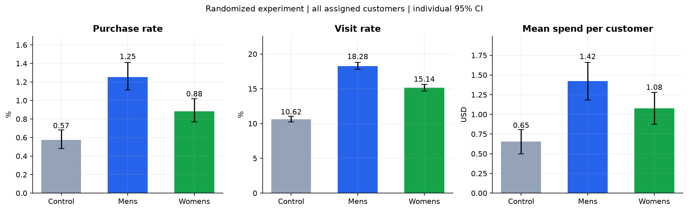

# 邮件营销 A/B 测试与因果增益分析

Email Campaign A/B Testing and Uplift Modeling

使用 Hillstrom 随机邮件实验，回答“邮件是否带来增量购买”和“预算有限时应该给谁发送”。项目展示 Python、统计检验、因果推断和增益模型能力。

**第一次看这个项目：** 先读本页，再按编号阅读 notebooks。完整分析放在 reports，方法与操作说明放在 docs。

## 01 项目目标

- 判断邮件对访问率、购买率和人均消费的平均影响。
- 比较男装邮件、女装邮件与不发邮件的差异。
- 检验客户特征是否对应不同营销效果。
- 比较全量、随机、响应预测和增益模型投放的离线收益。

## 02 数据与分析口径

| 项目 | 说明 |
| --- | --- |
| 数据规模 | 64,000 名客户，12 个字段，578 次购买 |
| 实验分组 | Mens E-Mail / Womens E-Mail / No E-Mail |
| 主要指标 | conversion：全部分配客户中的购买率 |
| 辅助指标 | visit：访问率；spend：包含零值的人均消费 |
| 模型特征 | 7 个实验前变量；不使用实验后的访问、购买和金额 |
| 数据划分 | 训练 60% / 验证 20% / 测试 20% |

无缺失；相同记录因没有客户 ID 而保留。SRM p=0.904，最大绝对 SMD=0.017。
字段与来源见 [数据字典](docs/02-data-dictionary.md)，统计方法与假设见 [分析方案](docs/01-analysis-plan.md)。

## 03 核心结果

| 问题 | 本次代码运行得到的结论 |
| --- | --- |
| 邮件是否增加购买 | 混合邮件策略提高购买率 **0.495 个百分点**，95% CI [0.351, 0.633] |
| 两种邮件是否相同 | 男装邮件的购买率、访问率、人均消费均高于女装邮件，固定比较通过 Holm 修正 |
| 选中了什么模型 | 验证集在 S/T/X 中选择 **S-Learner**；测试集只做评价 |
| 默认成本下怎么投放 | 验证集选择 **100% 覆盖** |
| 个性化是否更好 | 30% 预算下，相对随机投放的收益差区间跨零，尚未证明更优 |

“提高 0.495 个百分点”是绝对概率差。收益模拟采用每封邮件 0.02 美元、每次增量购买贡献利润 30 美元的场景假设，并非线上实绩。



[完整分析报告](reports/analysis.md) · [标准 Qini 图](reports/figures/09-qini-standard.png) · [策略收益图](reports/figures/07-policy-profit.png)

## 04 按顺序阅读

| 顺序 | Notebook | 对应源码 |
| --- | --- | --- |
| 01 | [数据审计](notebooks/01-data-audit.ipynb) | src/data.py |
| 02 | [实验验证](notebooks/02-experiment-validation.ipynb) | src/statistics.py |
| 03 | [A/B 测试](notebooks/03-ab-test-analysis.ipynb) | src/statistics.py |
| 04 | [因果效应](notebooks/04-causal-effect-analysis.ipynb) | src/causal.py |
| 05 | [增益模型与预算](notebooks/05-uplift-modeling.ipynb) | src/modeling.py、src/evaluation.py、src/budget.py |

Notebook 按“问题 → 方法与假设 → 代码 → 结果”展开，计算统一调用 src 中的实现。
详细操作见 [执行指南](docs/03-execution-guide.md)。

## 05 文件放在哪里

```text
email-campaign-causal-analysis/
├── data/raw/          原始数据
├── notebooks/         按 01–05 顺序学习
├── src/               数据、统计、因果、模型与报告代码
│   └── tools/         导入、Notebook 执行和打包工具
├── reports/
│   ├── analysis.md    完整分析报告
│   ├── figures/       9 张结果图
│   ├── tables/        全部结果 CSV / JSON
│   └── logs/          运行与验证记录
├── docs/              方法、字段、运行、面试和简历说明
├── tests/             关键统计和建模口径检查
├── run.py             统一分析运行入口
├── requirements.txt
├── requirements-lock.txt
└── README.md          项目阅读入口
```

所有结果表统一保存一份。环境和缓存属于工具文件，不参与阅读。GitHub 发布规则见 [执行指南](docs/03-execution-guide.md)。

## 06 复现项目

在项目根目录执行：

```powershell
python -m venv .venv
.\.venv\Scripts\python.exe -m pip install -r requirements-lock.txt
.\.venv\Scripts\python.exe run.py --stage all
.\.venv\Scripts\python.exe -m pytest -q
```

GitHub 仓库不包含原始 CSV。首次运行会自动下载并验证数据；已有通过校验的本地缓存时可离线读取。运行后，来源与获取方式记录在 reports/tables/data_provenance.json。
Notebook 可在 Jupyter 中打开，也可使用 `python src/tools/run_notebooks.py` 逐单元执行。

## 07 展示与面试

[项目总结](docs/project-summary.md) · [面试讲解](docs/04-interview-guide.md) · [中文简历四条](docs/resume-bullets.md)

局限性：历史实验只有 578 次购买，缺少客户 ID、分配日志和长期指标；分群与策略收益存在较大不确定性。模型只决定给谁发送混合邮件，没有实现男装/女装内容的个性化选择。完整假设、局限性与参考方法见 [分析报告](reports/analysis.md)。
