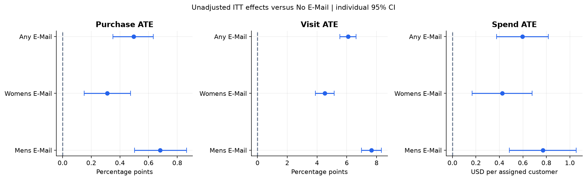
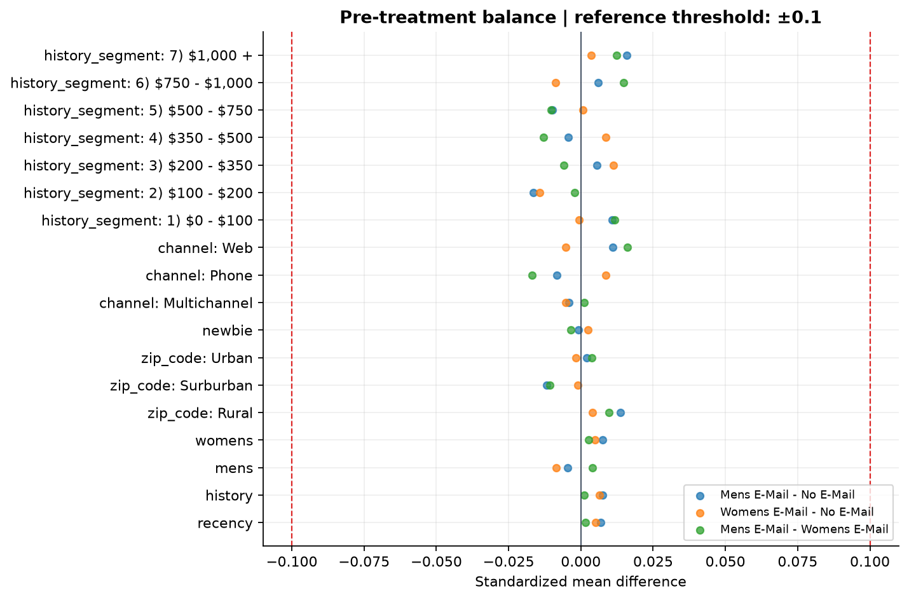
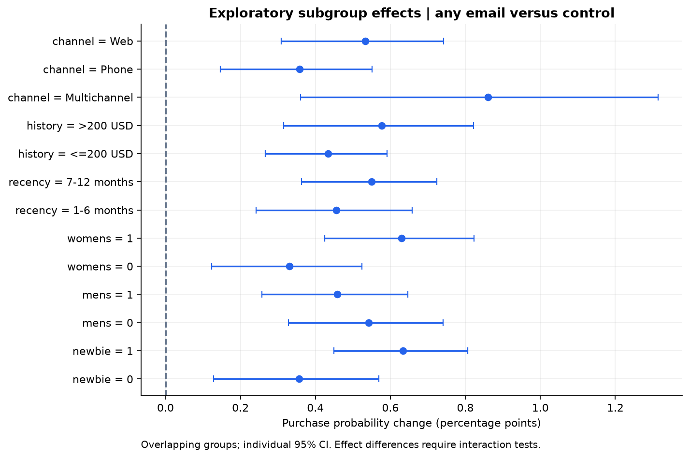
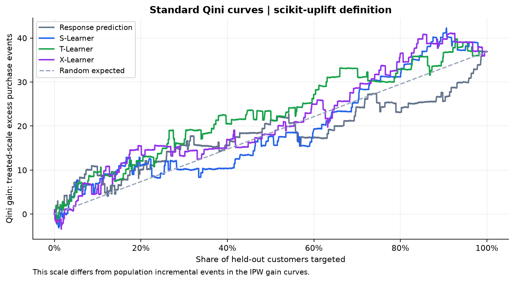
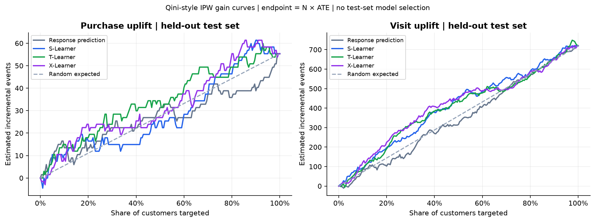
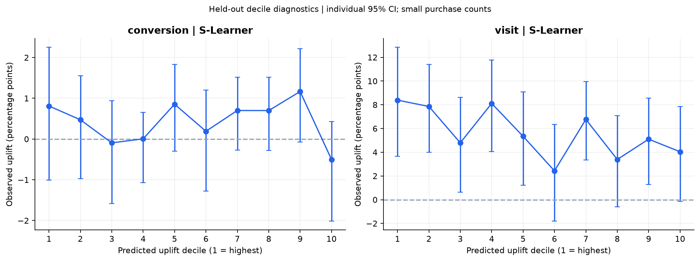
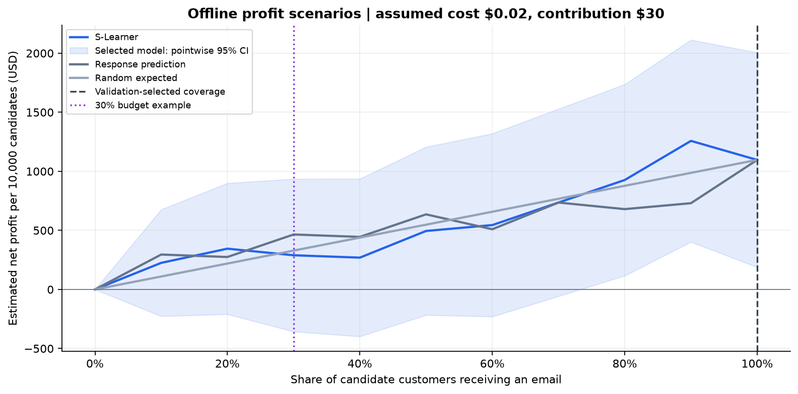
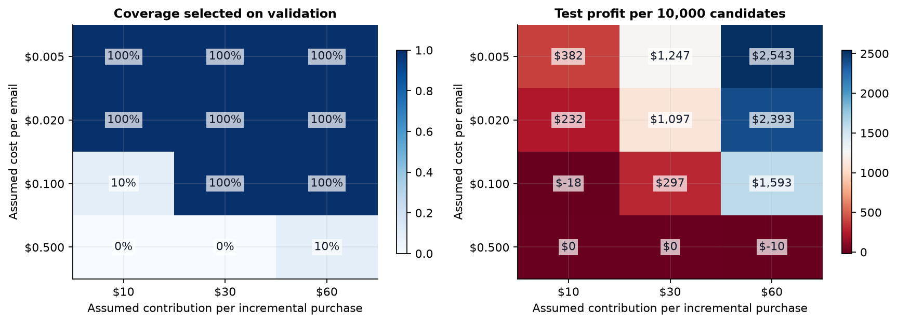

# 邮件营销 A/B 测试与因果增益分析

Email Campaign A/B Testing and Uplift Modeling

使用 Hillstrom 随机邮件实验，判断营销干预是否增加访问、购买和消费，并在有限预算下评价客户投放排序。项目补充 MySQL 电商购物漏斗作品集中的 Python、统计推断、因果分析和机器学习验证能力。

## 项目目标

1. 邮件是否真正带来增量，而不是把本来就会发生的购买归因于邮件？
2. 男装和女装邮件是否存在效果差异？
3. 实验前客户特征是否影响营销效果？
4. 在固定预算下，增益排序是否优于随机或购买概率排序？

## 数据概况

| 实验组 | 客户数 | 访问率 | 购买率 | 人均消费（美元） |
| --- | --- | --- | --- | --- |
| No E-Mail | 21,306 | 10.62% | 0.573% | 0.653 |
| Mens E-Mail | 21,307 | 18.28% | 1.253% | 1.423 |
| Womens E-Mail | 21,387 | 15.14% | 0.884% | 1.077 |

共 **64,000 客户、12 字段、578 次购买**；无缺失或结果字段逻辑异常。结果观察窗口是实验后两周。6,562 行完全相同，但没有客户 ID，不能认定为重复客户；保留原始实验样本。消费金额的 99.10% 为零，均值分析仍包含全部客户。

来源为 [Hillstrom 原始挑战](https://blog.minethatdata.com/2008/03/minethatdata-e-mail-analytics-and-data.html)，下载脚本使用 [scikit-uplift 官方数据接口所列镜像](https://www.uplift-modeling.com/en/latest/_modules/sklift/datasets/datasets.html)。本次因运行环境限制，数据取自用户已有压缩包中的原始 CSV；只提取数据，未复制其他项目代码。实际取得方式和校验值记录于 reports/tables/data_provenance.json。没有声称本次成功联网校验镜像压缩文件。

## 分析口径

- 客户记录为分析单位；主要指标 conversion，辅助指标 visit、含零值的人均 spend。
- 处理定义为分配到邮件组，估计 ITT；未观测实际打开或阅读邮件。
- Mens、Womens 分别对 No E-Mail；合并邮件指男装/女装随机混合策略，不是个性化内容选择。
- 两比例 z 检验 / Newcombe 区间，spend 用 Welch + 2,000 次 bootstrap；12 个固定比较统一 Holm 修正。
- 1:1:1 为计划分配假设，SRM p=0.904；最大绝对 SMD=0.017。分配日志缺失，检查通过不能证明来源实验一定没有设计问题。
- 仅使用 7 个实验前特征；训练/验证/测试=38,400/12,800/12,800。模型与覆盖比例只按验证集选择。

详细方法、假设和指标单位见 [分析方案](../docs/01-analysis-plan.md)、[字段说明](../docs/02-data-dictionary.md)。

## 核心结果：平均效应

| 对比 | 指标 | 绝对提升 | 相对提升 | 95% CI | Holm p |
| --- | --- | --- | --- | --- | --- |
| Mens E-Mail − No E-Mail | conversion | 0.681 个百分点 | 118.8% | [0.501, 0.864] | 1.22e-12 |
| Mens E-Mail − No E-Mail | visit | 7.659 个百分点 | 72.1% | [6.995, 8.323] | 6.82e-111 |
| Mens E-Mail − No E-Mail | spend | 0.770 美元 | 117.9% | [0.485, 1.055] | 6.89e-07 |
| Womens E-Mail − No E-Mail | conversion | 0.311 个百分点 | 54.3% | [0.150, 0.475] | 0.000628 |
| Womens E-Mail − No E-Mail | visit | 4.523 个百分点 | 42.6% | [3.889, 5.157] | 3.18e-43 |
| Womens E-Mail − No E-Mail | spend | 0.424 美元 | 65.0% | [0.169, 0.680] | 0.00226 |
| Any E-Mail − No E-Mail | conversion | 0.495 个百分点 | 86.5% | [0.351, 0.633] | 2.99e-09 |
| Any E-Mail − No E-Mail | visit | 6.088 个百分点 | 57.3% | [5.540, 6.629] | 1.92e-92 |
| Any E-Mail − No E-Mail | spend | 0.597 美元 | 91.4% | [0.376, 0.817] | 6.89e-07 |

合并邮件相对对照的购买率增加 **0.495 个百分点**，95% CI 为 [0.351, 0.633] 个百分点，相对提升 86.5%。绝对变化和相对变化单位不同，不能混淆。

男装邮件的购买率、访问率和人均消费高于女装邮件；三项组间比较在本项目固定的 12 个检验家族中通过 Holm 5% 修正。普通 95% 区间为逐项区间，Bonferroni 同时区间另存于 ab_results.csv。




Lin 完全交互回归的调整效应与均值差接近，见 reports/tables/ate_adjusted.csv。购买率的分群交互检验经 BH 修正后没有达到 5% 水平；不能仅凭分群点估计不同就声称发现了稳定异质性。





## 增益模型：预测谁买与预测谁被邮件影响

响应预测基线使用 logistic；S/T-Learner 使用固定参数的浅层梯度提升树；X-Learner 使用三折交叉拟合伪效应与两组回归器。

下表为购买结果的独立测试集评价。原始 AUUC 与 scikit-uplift 标准化 Qini 的定义不同，不能直接比较数值大小。

| 模型 | 原始 AUUC | AUUC 超过随机部分 | 标准化 Qini | Uplift@30% |
| --- | --- | --- | --- | --- |
| Response prediction | 0.002114 | -0.000047 | -0.0051 | 0.616 个百分点 |
| S-Learner | 0.002226 | 0.000065 | 0.0128 | 0.400 个百分点 |
| T-Learner | 0.002657 | 0.000496 | 0.0676 | 0.624 个百分点 |
| X-Learner | 0.002521 | 0.000360 | 0.0450 | 0.506 个百分点 |

验证集在三个增益模型中选中了 **S-Learner**。T-Learner 的测试指标更高属于测试诊断结果，不允许据此改选模型后再声称得到了无偏策略收益。S-Learner 测试排序优势较弱，项目不夸大增益模型有效性。响应预测的 ROC/PR AUC 作为分类诊断保存，不作为增益模型选择标准。







## 业务模拟与预算选择

假设每封邮件成本 **0.02 美元**，每次增量购买贡献利润 **30 美元**，候选客户 **10,000 人**。这些是教学场景，不是真实测得的客单价、营销成本或利润。

没有硬预算上限时，验证集选择 **100% 覆盖**；本次是全量发送。测试集估计全量发送增加 43.22 次购买/万人，假设净收益为 \$ 1,096.69，组内 bootstrap 95% CI [\$ 147.54, \$ 2,045.99]。低成本场景没有必要强行缩减到“个性化最佳人群”。

明确 30% 预算上限时，比例仍只按验证集选择：

| 策略 | 覆盖比例 | 增量购买/万人 | 邮件成本 | 假设净收益 | 净收益 95% CI |
| --- | --- | --- | --- | --- | --- |
| Selected | 30% | 11.65 | $60.00 | $289.51 | [$-379.00, $922.75] |
| Random expected | 30% | 12.97 | $60.00 | $329.01 | [$44.26, $613.80] |
| Response prediction | 30% | 17.51 | $60.00 | $465.31 | [$-202.50, $1098.55] |

增益策略相对同预算随机期望策略的净收益差为 \$ -39.50/万人，95% CI [\$ -553.04, \$ 456.05]。**30% 预算场景中，增益投放相对随机投放的收益差区间跨越零，不能证明个性化策略优于随机。**

同时保存 10%、50% 硬预算场景。全量发送对应 100% 预算，不能在 30% 预算下作为可执行的同预算选项。不同覆盖比例曲线仅作描述，未用测试峰值重新选择比例。





成本 0.005/0.02/0.10/0.50 美元 × 贡献利润 10/30/60 美元的敏感性场景说明：成本足够高时，验证集会选择完全不发送。验证集选择也可能不能在测试集稳定复现收益，负点估计原样保留。

## 项目导航

目录与阅读顺序见 [项目首页](../README.md)。

## 运行方法

Windows PowerShell：

```powershell
python -m venv .venv
.\.venv\Scripts\python.exe -m pip install -r requirements-lock.txt
.\.venv\Scripts\python.exe run.py --stage all
.\.venv\Scripts\python.exe -m pytest -q
.\.venv\Scripts\python.exe src/tools/run_notebooks.py
```

不需要激活环境或更改系统执行策略。跨系统环境可使用 requirements.txt；本次实际依赖全量锁定在 requirements-lock.txt。详情见 [逐步执行指南](../docs/03-execution-guide.md)。

## 项目成果

独立源码与随机实验审计、A/B/ATE 结果、探索性分群分析、响应预测基线、S/T/X-Learner、Qini/AUUC/Uplift@K 与分位数组、验证集锁定策略、三种硬预算场景、12 种成本价值场景、9 张图和编号教学 Notebook。方法测试覆盖不等组分配下的增量估计、分母定义、特征防泄漏、样本不重叠、排序方向及真实数据契约。

[项目总结](../docs/project-summary.md) · [面试讲解](../docs/04-interview-guide.md) · [中文简历四条](../docs/resume-bullets.md)

## 局限性

- 历史公开实验，没有分配日志、客户 ID 或长期追踪，不能验证干扰、实际打开邮件、退订和长期客户价值。
- 购买事件仅 578 次，测试集更少，客户级异质性和策略差值区间较宽。机器学习不保证优于简单投放。
- 分群是探索分析；普通逐项区间不是同时区间。响应预测的关联能力不等于因果效应。
- bootstrap 条件于固定已训练策略，不包含重新训练和模型选择的不确定性。
- 预算、成本与贡献利润是场景假设；收益是离线估计，不是线上已实现利润，也不是直接用模型分数求和。
- 本模型只判断给谁发混合邮件；未建立选择男装/女装内容的多处理投放模型。
- 原始数据的公开可访问性不自动等于明确的再分发许可。GitHub 默认不提交原始数据；代码不把数据的许可问题覆盖为项目代码许可。

## 参考方法

[Meta-learners 原始论文](https://arxiv.org/abs/1706.03461)；
[scikit-uplift Qini 定义](https://www.uplift-modeling.com/en/latest/api/metrics/qini_auc_score.html)；
[scikit-uplift 标准化 uplift AUC](https://www.uplift-modeling.com/en/latest/api/metrics/uplift_auc_score.html)；
[statsmodels 两比例差区间](https://www.statsmodels.org/stable/generated/statsmodels.stats.proportion.confint_proportions_2indep.html)。

源码及分析独立编写，官方文档用于核对接口、数据字段及指标定义。
